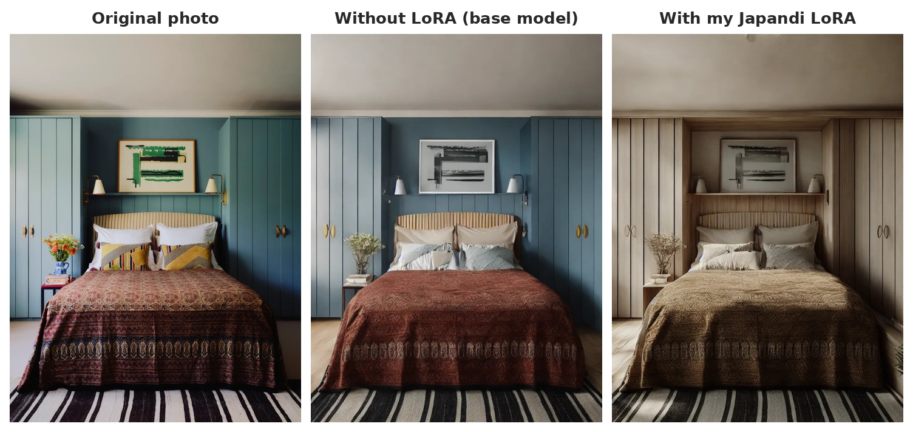
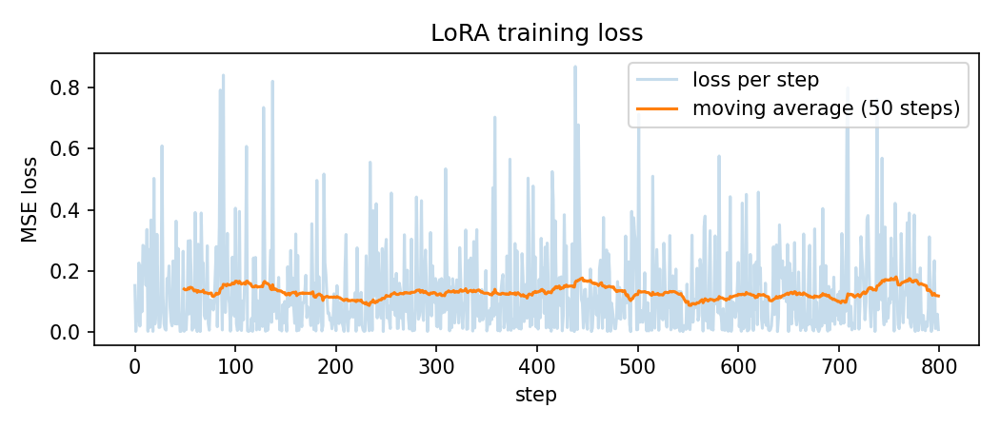
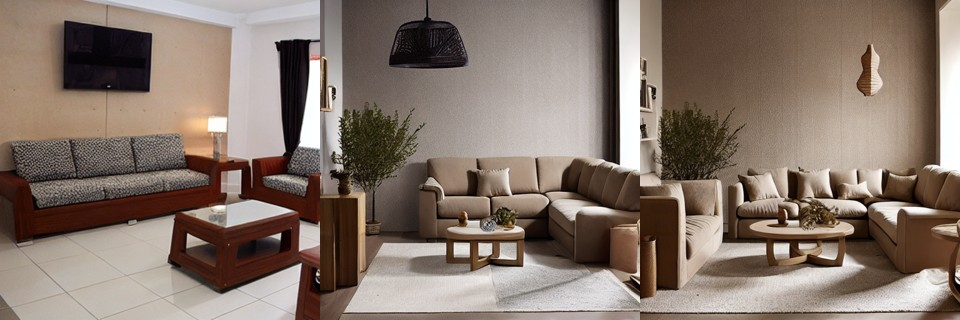
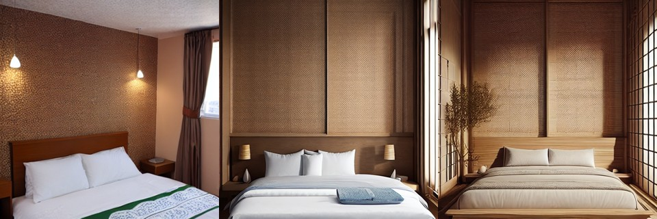
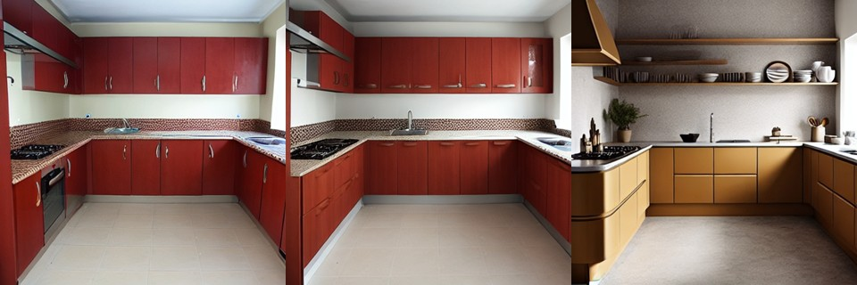
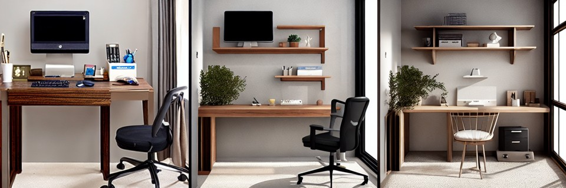

# Japandi Style LoRA: Teaching Stable Diffusion an Interior Style

I trained my own LoRA to teach Stable Diffusion 1.5 the **Japandi** interior style (light wood, beige and linen textures, low furniture, paper lamps), measured what it learned, and combined it with ControlNet so a real room keeps its layout while its style changes.

[](https://huggingface.co/spaces/Mervecaliskan/japandi-room-restyle)

🚀 **Try the live demo:** [Japandi Room Restyle on Hugging Face Spaces](https://huggingface.co/spaces/Mervecaliskan/japandi-room-restyle). Upload a room photo and compare the result without and with the LoRA.

🤗 **The LoRA:** [Mervecaliskan/japandi-interior-lora](https://huggingface.co/Mervecaliskan/japandi-interior-lora) (6.4 MB, trigger word `jpdi`)


*Same prompt, seed and settings; only the LoRA changes. The blue cabinets become light wood, the red bedspread and patterned cushions turn beige and linen, while the cabinets, shelf, lamps and rug stay in place.*

This project builds on my earlier work on [keeping the design in AI interior renders](https://github.com/Mervecaliskann/interior-render-preservation), where Canny ControlNet + img2img kept the geometry best.

## Key findings

- **A small LoRA learned the style.** 17 images, 0.19% of the UNet parameters, 4.9 minutes on a free T4 GPU, 2.1 GB peak memory. The result is a 6.4 MB file.
- **Style up, prompt kept.** CLIP style similarity to the training photos rose from 0.775 to 0.881, while prompt match did not drop (0.274 → 0.285): a kitchen is still a kitchen.
- **No copying.** The highest similarity of any output to a single training photo was 0.92, below the 0.95 level where I would suspect memorization.
- **The style transfers to new rooms.** A home office, which was not in the training set, became Japandi too. A bathroom changed only partly.
- **Data balance matters.** With 7 living rooms but only 2 kitchens, kitchens barely changed at LoRA strength 0.5.
- **Keeping the layout limits the style.** With ControlNet fully on and img2img strength 0.6, the LoRA changed very little. The best balance in the app was img2img strength 0.9 with ControlNet scale 0.8.

## How it works

| Step | What I did |
|---|---|
| Data | 17 Japandi interiors (7 living rooms, 5 bedrooms, 2 dining rooms, 2 kitchens, 1 detail). I removed collages, watermarked, blurry and off-style images. |
| Captions | Each image gets its room type: *"a photo of a jpdi style bedroom"*. The room word explains **what** is in the photo, so the trigger word only has to learn the **style**. |
| Training | LoRA rank 8 on the UNet attention layers (`to_q`, `to_k`, `to_v`, `to_out`), 800 steps, learning rate 1e-4, 512×512, horizontal flips. My own training loop with `diffusers` + `peft`. |
| Memory | Latents and text embeddings computed once, then the VAE and text encoder removed from the GPU. Frozen weights in fp16, LoRA weights in fp32, autocast, gradient scaling, gradient checkpointing. |
| Evaluation | 5 room types × LoRA strength 0, 0.5, 1.0 with the same seed, scored with CLIP. |
| App | Canny ControlNet + img2img keeps the layout, the LoRA brings the style. Gradio on a ZeroGPU Space, about 3 s for both images. |

## Results

### 1. Training



The loss is noisy and stays flat. This is normal for diffusion training: each step uses a random noise level, so the loss jumps between easy and hard steps. I judged the LoRA by generated images and metrics, not by the loss curve.

### 2. What the LoRA learned (text to image)

Same prompt and seed, LoRA strength **0 | 0.5 | 1.0**:

<p>




</p>

| LoRA strength | Style similarity ↑ | Prompt match ↑ | Max similarity to a training photo |
|---|---|---|---|
| 0.0 | 0.775 | 0.274 | 0.775 |
| 0.5 | 0.854 | 0.273 | 0.858 |
| **1.0** | **0.881** | **0.285** | 0.887 |

*Style similarity: CLIP similarity to the average of the training photos. Prompt match: CLIP similarity to the room prompt. The last column is the average of each output's highest similarity to any single training photo; above 0.95 would suggest copying.*

| Room | Style similarity at 0 → 1.0 | In training set? |
|---|---|---|
| Living room | 0.777 → 0.928 | yes (7) |
| Bedroom | 0.757 → 0.880 | yes (5) |
| Kitchen | 0.753 → 0.880 (0.818 at 0.5) | yes (2) |
| Home office | 0.768 → 0.858 | **no** |
| Bathroom | 0.821 → 0.858 | **no** |

### 3. Restyling a real room (LoRA + ControlNet)

On a real photo, two settings decide how much the style can change: **img2img strength** (how much of the photo is redrawn) and **ControlNet scale** (how strictly the edges are kept). I tested them on a living room photo in the app:

| img2img strength | ControlNet scale | What the LoRA changed |
|---|---|---|
| 0.60 | 1.0 | Almost nothing; the result stays close to the original |
| 0.75 | 1.0 | Small elements appear (a rattan pendant lamp) |
| 0.80 | 0.8 | Lamp and wooden details are clear |
| **0.90** | **0.8** | **Furniture changes too (a leather ottoman becomes a slatted wooden table); the layout stays** |

In every test the base model without the LoRA turned an open kitchen into an outdoor view, while the LoRA version kept it as an interior.

## What went wrong and what I learned

- **First dataset was unusable.** Of 11 downloaded images, only 2 were good: some were broken downloads, others were collages, blurry, or a different style (mid-century, boho). One had a watermark the model would learn. I rebuilt the set with clear rules: one style, several room types, no text.
- **All living rooms at first.** My second batch had only living rooms, so the LoRA would have learned "Japandi = sofa and coffee table". I added bedrooms, dining rooms and kitchens.
- **The loss did not tell me much.** It stayed flat, so I evaluated with images and CLIP metrics instead.
- **Kitchens were weak at strength 0.5.** Only 2 kitchen images. More examples of under-represented rooms, or a higher strength, fix this.
- **The style hardly showed on real photos at first.** With ControlNet scale 1.0 and img2img strength 0.6, the edges locked every object and img2img kept the original colors. Lowering ControlNet scale to 0.8 and raising img2img strength to 0.9 let the style through while the layout stayed. This is the same trade-off as in my [earlier project](https://github.com/Mervecaliskann/interior-render-preservation): keeping a design and changing it compete.
- **The LoRA adds and recolors, but does not repaint everything.** In the living room, the dark cushions stayed dark. To recolor one specific object, mask-based inpainting is the better tool.
- **Library changes break code.** A newer `transformers` changed what `get_image_features` returns, so I computed CLIP embeddings from the vision and text models directly.

## Limits

- One seed per prompt and CLIP-based metrics only, so the numbers show a direction, not a precise score.
- The app settings were tuned on a few photos; other rooms may need different values.
- Part of the training set is AI-generated renders, not real photos. The training images are not shared because of copyright.
- SD 1.5 at 512 px; a newer base model (SDXL, Flux) would give sharper results.

## Next steps

- More kitchen and bathroom images, and several seeds per prompt.
- Combine the LoRA with mask-based inpainting to restyle only chosen objects.
- Train the same style on SDXL and compare quality, speed and memory.

## Files

| Path | What |
|---|---|
| [`japandi_style_lora.ipynb`](japandi_style_lora.ipynb) | Data preparation, LoRA training, evaluation (Colab or Kaggle, T4 GPU) |
| [`app/`](app/) | The Gradio app running on the Space |
| [`results/`](results/) | Comparison images, loss curve, metrics (`lora_metrics.csv`) |

## How to run

**Demo:** open the [Hugging Face Space](https://huggingface.co/spaces/Mervecaliskan/japandi-room-restyle), no setup needed.

**Use the LoRA:**
```python
import torch
from diffusers import StableDiffusionPipeline

pipe = StableDiffusionPipeline.from_pretrained(
    "stable-diffusion-v1-5/stable-diffusion-v1-5", torch_dtype=torch.float16).to("cuda")
pipe.load_lora_weights("Mervecaliskan/japandi-interior-lora")
image = pipe("a photo of a jpdi style bedroom", cross_attention_kwargs={"scale": 1.0}).images[0]
```

**Train your own:** open the notebook in Colab or Kaggle with a T4 GPU, upload 15 to 25 images of one style (file names like `bedroom_01.jpg` give each image its caption), and run the cells in order.

**Tech:** Python, PyTorch, Hugging Face `diffusers`, `transformers` and `peft`, Stable Diffusion 1.5, LoRA, ControlNet (Canny), CLIP, Gradio, Hugging Face Spaces (ZeroGPU), OpenCV, pandas, matplotlib.

## Author

**Merve Caliskan** · [GitHub](https://github.com/Mervecaliskann) · [LinkedIn](https://www.linkedin.com/in/mervecaliskann) · [Medium](https://medium.com/@mervcaliskaan)
